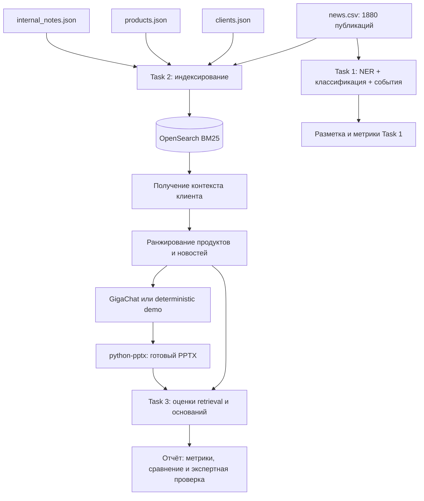

# Архитектура, источники данных и связи между заданиями

## 1. Общий контур



## 2. Входные данные

| Файл | Формат | Роль | Примечания |
|---|---|---|---|
| `task1/data/news.csv` и `task2/data/news.csv` | 1880 строк, `title`, `text`, `source` | статьи для Task 1 и индекс Task 2 | дата и прямой URL статьи часто отсутствуют |
| `task2/data/clients.json` | словарь | 8 клиентских профилей | заданные профили, не финансовая отчётность |
| `task2/data/products.json` | словарь | 10 финансовых продуктов | определения, не подтверждённые предложения |
| `task2/data/internal_notes.json` | список | качественные экспертные рекомендации и оговорки | критически важны для ранжирования |
| `task1/reference/news_final_annotation.csv` | CSV | контрольная разметка для Task 1 | частично проверена; есть флаги сомнений |
| `task3/evaluation/gold.json` | JSON | эталон Task 3 | неполный набор меток релевантности и отрицательных кейсов |

`news.csv` продублирован в `task1/data/` и `task2/data/`, чтобы задания можно было запускать по отдельности.

## 3. Retrieval в Task 2

- Индекс: русский анализатор, BM25, фильтр `client_ids`, две текстовые части `title`/`content`.
- `client_ids` формируются по упоминаниям клиента в заголовке и начале новости. Это более строго, чем поиск любой строки по всему тексту; возможны пропуски.
- Если включен `NEWS_CHUNK_SIZE`, **только новости** разбиваются на перекрывающиеся части в индексе. При выдаче чанки обратно сворачиваются в исходные статьи, чтобы не завысить число новостей в презентации. `NEWS_CHUNK_SIZE=0` — оригинальное поведение.
- Это RAG с **лексическим retrieval (BM25)**, а не vector DB или embedding similarity retrieval. Генератор получает уже отобранные данные; GigaChat формулирует summary/fit/questions, а не изобретает документы.

## 4. Контракт вывода Task 2

`task2/src/writer.py` собирает контекст из ID и текстов. Модель должна вернуть JSON:

```json
{
  "summary": "Краткий профиль и риск",
  "product_fit": {"IRS": "Обоснование, со ссылкой на риск клиента"},
  "questions": ["Вопрос 1", "Вопрос 2", "Вопрос 3"]
}
```

`task2/src/presentation.py` использует этот JSON, профили, продукты и новости для семи слайдов: титул, клиент, риски, продукты, новости, вопросы, источники. Выдаётся и `.json` со следом решения (выбранные продукты, исходные ID новостей, backend), важный для аудита Task 3.

## 5. Валидация Task 3

`task3/evaluation/agent_runner.py` запускает агента как отдельный процесс и сохраняет observations; `task3/evaluation/metrics.py` сопоставляет их с `task3/evaluation/gold.json`; `task3/evaluation/compare.py` считает попарные разницы и bootstrap-интервал; `task3/evaluation/pptx_checks.py` проверяет структуру файлов PowerPoint. В `manifest.json` фиксируются SHA-256 данных, gold, исходников, указанного промпта и белый список параметров эксперимента — без API-ключей.
